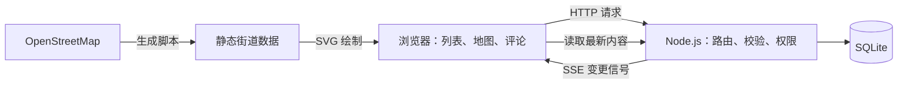

# discountShow

**分享学校周边门店的特价，也让后来的人知道还有没有货。**

discountShow 是一个面向学校周边学生的线下门店特价分享网站，覆盖超市、亚洲杂货店和便利店。用户可以分享店内折扣，并持续补充价格、有效期和库存信息，帮助其他人判断是否值得到店购买。

不登录也能浏览和搜索特价；登录后，可以发布帖子、确认信息、提出纠错、报告库存，以及上传价签照片和参与评论。

[在线体验](https://comp4020-final-hhhfff-hhhfff.fly.dev/) · [英文项目说明](../README.md) · [开发过程](../PROCESS.md)

## 界面预览

### 找特价、看附近的店

列表用价签样式突出价格，并显示信息的新鲜程度和最近的库存报告。新帖子先以提示按钮出现，点击后才载入，避免把正在阅读的内容挤走。桌面上的卡片采用瀑布流，展开评论时不会在旁边一列留下整块空白。


地图展示附近店铺及其在售特价数量。点击店铺可以进入对应页面，查看特价、打开导航或分享链接。地图使用预先保存的 OpenStreetMap 数据，浏览时不需要调用第三方地图服务。


### 手机上的阅读与互动

手机端可以查看价签照片、库存变化和评论，也支持暗色模式。地图保持较低的高度，让第一屏留出展示特价的位置。

<p>
  
  
  
</p>

从左到右：特价卡片、评论区、暗色模式。

<p>
  
  
  
</p>

从左到右：街道地图、发帖表单、店铺页。每条特价也有独立链接，方便发给朋友。

## 一条特价怎样被更新

一个人看到折扣后，可以选择店铺，填写商品、原价、现价、截止日期和信息来源，再按需附上价签照片。页面会提示可能重复的商品；服务端也会检查，同一家店的同一件商品只能有一条有效帖子。

后来到店的人可以确认“我也看到了”，或者补充新的库存情况。如果价格、商品名或截止日期有误，也可以提出纠错。规则如下：

| 情况 | 处理方式 |
| --- | --- |
| 发布或修改价格 | 特价必须低于原价；纠错同样需要通过校验 |
| 发帖人修改自己的帖子 | 纠错立即生效 |
| 其他人提出纠错 | 需要 3 个不同账号支持同一项修改；重复投票不累计 |
| 报告库存 | 可选很多、还有、只剩几个或售罄；每个账号对同一帖子每分钟限报一次 |
| 商品售罄 | 帖子排到列表后面，并显示近期库存报告，方便读者了解变化 |
| 评论或照片被举报 | 达到 10 个不同账号后自动隐藏，交由管理员处理 |

已显示帖子的库存、评论和纠错会实时更新；有人正在卡片里输入内容时，页面会暂缓替换那张卡片。连接状态由顶栏的 Live 标记显示。卡片和店铺页还会显示有多少其他人正在查看，只显示人数，不公开读者身份。

这些机制能让信息更容易核对，但不能保证每条特价都属实。价签照片也是判断依据之一，拍摄后价格和库存仍可能变化。

## 账号与管理

游客可以浏览、搜索和查看评论、照片；登录后才能贡献内容。发帖人可以管理自己的帖子和照片，管理员可以处理其他人的帖子、评论、照片及举报。

管理员身份只由服务器的 `ADMIN_USERS` 配置决定，不能通过注册或接口自行获得。所有权限都在服务端检查，页面是否显示按钮不影响权限判断。

<details>
<summary>查看管理员举报收件箱</summary>

<p>
  
</p>

被隐藏和举报较多的内容优先显示，管理员可以恢复、保持隐藏或删除。

</details>

## 技术栈与整体结构

应用运行在一台 256 MB 内存的 Fly.io 共享 CPU 机器上，采用单个 Node.js 进程和 SQLite 数据库。页面、接口和实时事件流由同一个服务提供，不需要额外部署数据库服务器、消息队列或地图服务。

| 层次 | 使用的技术 | 负责的内容 |
| --- | --- | --- |
| 前端 | 原生 HTML、CSS、JavaScript ES Modules | 特价列表、表单、评论、瀑布流、主题切换和地图交互 |
| HTTP 服务 | Node.js 24、TypeScript、`node:http` | 路由、输入校验、权限检查、分页和静态资源 |
| 数据存储 | `node:sqlite`、SQLite WAL 模式 | 账号、帖子、纠错、库存、评论、照片和通知 |
| 实时通信 | Server-Sent Events、浏览器 EventSource | 通知页面读取发生变化的帖子，以及更新连接和在看人数状态 |
| 地图 | OpenStreetMap、Overpass、SVG | 离线生成街道数据，浏览器内绘制、拖动和缩放 |
| 安全与资源处理 | `node:crypto`、`node:zlib`、Canvas | 密码哈希、会话令牌、gzip 压缩和照片重编码 |
| 检查与部署 | TypeScript、Vitest、jsdom、Docker、GitHub Actions、Fly.io | 类型检查、接口和页面测试、容器化与持续集成 |

Node.js 24 直接运行 TypeScript 源文件，前后端都没有构建步骤。运行时的外部依赖只有用于展示英文 README 的 `marked`；类型检查和测试工具属于开发依赖。



## 关键实现

### 数据一致性：查重和纠错都在事务内完成

商品名在比较前会经过 Unicode 规范化、大小写转换、标点清理和规格单位合并。例如 `Tim Tams 200 g` 和 `tim-tams 200G` 会得到相同的商品键。发帖前的相似商品提示还会结合单词重叠与字符三元组，提醒用户先查看已有帖子；是否允许写入则由服务端最终判断。

“同店同商品只保留一条有效帖子”的检查和写入放在同一个 SQLite 事务里，避免多人同时提交时各自通过查重。价格以整数分存储，减少浮点计算带来的金额误差；有效期按堪培拉日期判断。

纠错记录保留修改字段、目标值、提交人及时间。相同账号对同一字段重新提议时会替换其未解决的提议，不会增加票数。发帖人的纠错立即生效，其他人需要 3 个不同账号支持同一项修改；达到条件后仍会重新检查价格关系和商品重复情况。库存报告另有每分钟一次的限制，页面展示最近 5 次报告，方便读者了解变化。

### 实时更新：SSE 通知变化，HTTP 读取内容

每个打开的页面通过 `/api/events` 建立一条 SSE 长连接。普通帖子变更事件只携带事件类型和帖子 ID，不把完整帖子、评论或账号凭证放进广播里。页面收到事件后，只重新读取当前显示的相关帖子；发帖人的私人通知只发送到该账号的连接。连接建立时的随机 stream ID 也只发给对应页面。

已有帖子的价格、库存和评论可以及时更新，新帖子则先显示“有新特价”的按钮，点击后再加载。正在编辑的卡片会暂缓替换，避免输入中的内容丢失。页面也处理“自己的新帖推送先于提交响应到达”的情况，防止把刚发布的帖子再次算进新帖提示。

服务端每 25 秒发送心跳，帮助连接穿过代理并保持活跃；连接数限制为 300，断开后清理连接及其查看状态。前端用 Live 标记区分连接中、正常、重连和已关闭状态。方案及取舍见 [ADR 0001](../docs/decisions/0001-multi-user-decision.md)。

### 在看人数：按身份去重，合并通知

页面通过 `/api/watch` 报告当前显示的帖子和店铺，服务端根据活跃连接计算人数。已登录用户开多个标签页只计为一个人，游客按页面计数；因此这里展示的是即时活动情况，不是精确的独立访客统计。

查看状态保存在内存中，不写入浏览历史。人数变化会先合并，再通过不带数据的 `here` 信号通知页面读取 `/api/here`；统计结果也会缓存到下一次变化。前端延迟并错开读取请求，后台标签页恢复显示后再更新，减少短时间内集中请求。接口只返回人数，不返回谁在看。设计说明见 [ADR 0002](../docs/decisions/0002-presence-counts.md)。

### 搜索与分页：区分准确匹配和拼写容错

搜索由服务端完成，范围包括商品名、店铺名、地区和店铺类型。每个搜索词都必须匹配其中一项，结果再按匹配程度排序。匹配支持整词、词首、词尾变化、跨空格输入和中文片段，例如 `dumpling` 与 `dumplings`、`timtams` 与 `Tim Tams`。

较长的英文单词允许少量拼写错误，但只在没有准确结果时启用，短词不做这种容错，避免把 `cola` 匹配成 `Coles`。发帖查重与搜索采用不同的判断逻辑：前者提示可能重复的商品，后者帮助读者找到相关结果。

页面每页展示 10 条，服务端返回当前页数据和 `x-total-count` 总数。排序先区分售罄状态，再考虑搜索匹配程度、发布时间和 ID。搜索词、店铺及页码写入网址，支持刷新、分享和浏览器返回；接口还提供 `after` 游标供连续读取。

服务端先读取轻量的排序字段，只为当前页加载完整帖子。按店铺和搜索条件缓存的排序列表最多保留 50 份，并在影响列表的写入或日期变化后失效。支持 gzip 的浏览器会收到压缩后的脚本、样式和地图数据，同一静态文件的压缩结果可复用。

### 地图与瀑布流：浏览器内完成绘制和布局

`scripts/streets.ts` 通过 Overpass 获取学校周边的道路、建筑、绿地和水域，进行投影与简化后保存为 `public/streets.json`。前端使用 SVG 绘制街道、店铺和标签，并处理拖动、滚轮和双指缩放。地图数据随应用提供，日常浏览不请求第三方地图 API。

店铺圆点展示在售特价数量，最近有发帖或库存报告时会出现涟漪。这些变化使用店铺接口中的数量和时间字段，不需要额外的地图推送通道。Near me 功能使用浏览器定位在本机重排店铺，不向服务器上传坐标。

多列列表会把卡片放入当前最短的一列，并使用 `ResizeObserver` 监听尺寸变化。展开评论或纠错时，按卡片实际高度重新安排同列内容，保持当前页面的列分配，避免旁边的卡片因为对齐行高而留下空白。手机端改为单列，发帖表单从底部展开；主题选择保存在本机，并在样式加载前应用，减少切换时的闪烁。

### 照片、账号与内容管理

价签照片先在浏览器中缩到最长边 1280 像素，通过 Canvas 重新编码为 JPEG，再提交到服务端。服务端限制上传大小为 600 KB，并解析 JPEG 段，移除 EXIF、GPS、XMP 等元数据后保存，同时保留解码所需的信息。只有发帖人能添加或替换照片，发帖人和管理员能删除；照片还有到期清理和总存储预算限制。

密码使用随机盐和 scrypt 派生哈希，验证时使用恒定时间比较。登录生成随机会话令牌，数据库只存令牌的 SHA-256 哈希；浏览器通过 `HttpOnly`、`SameSite=Strict` cookie 保存令牌，在 HTTPS 环境中增加 `Secure`。同一用户名一分钟内连续输错 5 次会暂停登录尝试。

请求身份只从会话 cookie 解析，公开的用户 ID 或请求体中的身份字段不能作为凭证。数据库查询使用参数化 SQL，用户文本通过 `textContent` 渲染；分享页的标题与预览内容也经过转义。登录页的 `next` 参数只允许返回本站页面。

评论支持回复、点赞和删除。评论或照片达到 10 个不同账号举报后，计数与隐藏在事务内完成，避免并发举报重复触发；管理员可以恢复、保持隐藏或删除。服务端操作日志使用结构化 JSON，记录账号、动作、目标和结果，包括被拒绝的操作，不记录密码、会话令牌或评论正文。

### 主要接口

| 接口 | 用途 |
| --- | --- |
| `GET /api/stores` | 店铺列表、在售数量和最近活动时间 |
| `GET /api/deals`、`GET /api/deals/:id` | 搜索、分页和读取帖子 |
| `GET /api/deals/similar` | 查找同店可能重复的商品 |
| `POST /api/deals` | 发布特价 |
| `POST /api/deals/:id/confirm` | 确认特价 |
| `POST /api/deals/:id/corrections` | 提出纠错 |
| `POST /api/deals/:id/stock` | 报告库存 |
| `GET /api/deals/:id/comments`、`POST /api/deals/:id/comments` | 读取评论、发表评论或回复 |
| `GET /api/deals/:id/photo`、`POST /api/deals/:id/photo` | 读取和上传价签照片 |
| `GET /api/events`、`POST /api/watch`、`GET /api/here` | 实时事件、查看状态和人数统计 |
| `GET /api/me`、`POST /api/register`、`POST /api/login`、`POST /api/logout` | 会话和账号操作 |
| `GET /api/reports` | 管理员举报收件箱 |

写接口会检查会话及对应权限。完整的路由与校验逻辑见 [`server/server.ts`](../server/server.ts)。

## 本地运行

需要 **Node.js 24 和 pnpm 11 或更新版本**。如果使用 mise，可以先运行 `mise install`，按仓库配置安装工具。

```bash
git clone https://github.com/HHHFFF-HHHFFF/discountShow.git
cd discountShow
pnpm install
pnpm dev
```

默认访问 <http://localhost:8080>。`pnpm dev` 会在服务端代码变化后自动重启。需要指定数据目录或管理员时，可以这样启动：

```bash
PORT=8080 DATA_DIR=.localdata ADMIN_USERS=admin node server/server.ts
```

Windows PowerShell：

```powershell
$env:PORT = "8080"
$env:DATA_DIR = ".localdata"
$env:ADMIN_USERS = "admin"
node server/server.ts
```

`ADMIN_USERS` 填写管理员用户名，多个用户名用逗号分隔；对应账号仍需注册。未配置时也可以正常使用普通用户功能。

### 测试

```bash
pnpm check
```

这会运行 TypeScript 类型检查和测试。默认情况下，测试在临时数据目录中启动独立应用，结束后清理，不需要先启动开发服务器。若设置了 `APP_URL`，测试会使用指定实例；请使用专门的临时实例，不要指向日常使用的数据。针对非本机地址的写请求还有额外拦截。

当前测试包含 25 个测试文件、119 条测试，覆盖价格与查重、三人纠错、库存报告、账号权限、照片与举报、搜索分页、分享链接、实时事件和操作日志。

接口测试向实际运行的服务发送 HTTP 请求，使用真实注册的测试账号检查权限与多用户操作。并发场景覆盖同时发帖、举报阈值和纠错后出现重复商品等情况。页面测试则在 jsdom 中运行实际的页面脚本，用可控事件流检查推送与响应的先后顺序、在看人数和瀑布流的分列逻辑。测试方式和隔离规则见 [spec/README.md](../spec/README.md)。

这些检查不能代替真实浏览器中的布局和交互测试，也不能证明学生会长期使用这个网站。

### 更新地图数据

```bash
node scripts/streets.ts
```

脚本通过 Overpass 获取 OpenStreetMap 数据，并生成 `public/streets.json`；原始响应缓存在 `.osm-cache/`。日常启动应用不需要运行这一步。

## 代码导航

| 目录或文件 | 内容 |
| --- | --- |
| `server/server.ts` | HTTP 路由、输入校验、静态文件和页面响应 |
| `server/db.ts` | SQLite 存储、事务和众包规则 |
| `server/auth.ts` | 角色权限、密码哈希和会话 |
| `server/events.ts` | SSE 推送与在看人数统计 |
| `server/match.ts` | 商品名匹配与搜索 |
| `server/photos.ts`、`server/log.ts` | 照片处理与操作日志 |
| `public/` | 页面、样式、交互脚本和地图数据 |
| `spec/` | 接口与页面行为测试 |
| `docs/` | 开发规则、设计决策和截图 |

页面入口包括 `/`、`/stores`、`/stores/:id`、`/deals/:id` 和 `/login`。根目录的英文 `README.md` 也会完整展示在应用的 `/readme/` 页面。

## 部署与项目记录

线上应用从[课程仓库](https://github.com/comp4020-agentic-coding-studio/comp4020-final-hhhfff-hhhfff)部署到 Fly.io，SQLite 数据保存在 `/data` 持久卷中。这个个人仓库保留项目代码和记录，CI 运行检查，但不触发线上部署。

GitHub Actions 会安装依赖、构建 Docker 镜像，再用临时 `/data` 启动容器并执行类型检查和测试；同时检查过程记录引用的提交，并扫描提交历史中的密钥。课程仓库在检查通过后部署应用并检查线上 HTTP 响应，个人仓库跳过部署步骤。容器使用 `node:24-alpine`，直接运行源文件；数据库和照片随持久卷保留，连接及在看人数等临时状态在进程重启后重新建立。

关于实现以外的思考，可以继续阅读：

- [PROCESS.md](../PROCESS.md)：项目起点、开发中的判断和改进。
- [reflections/](../reflections/)：各次课堂评议后的反思。
- [research-note.md](../research-note.md)：对 agent 工作流复杂度的讨论。
- [docs/development.md](../docs/development.md)：开发时需要遵守的具体规则。

地图数据来自 [OpenStreetMap contributors](https://www.openstreetmap.org/copyright)，按 ODbL 许可使用。

## 目前的限制

信息更新仍依赖参与者。贡献者较少时，库存可能过时，三人共识纠错也可能迟迟无法生效；地图动画和在看人数是否有实际帮助，还需要继续观察。实时连接目前最多支持 300 个页面。

项目主要展示当前价格和库存，暂不提供价格历史、网站抓取和小票照片。历史购买记录不能直接说明现在还有货，抓取也覆盖不了没有网站的小店。邮箱登录和自助找回密码目前尚未实现，因此账号恢复也是现有的限制。
