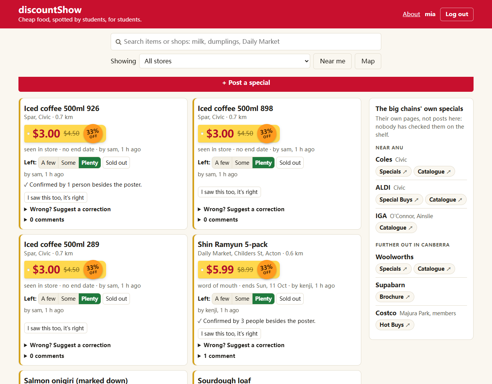
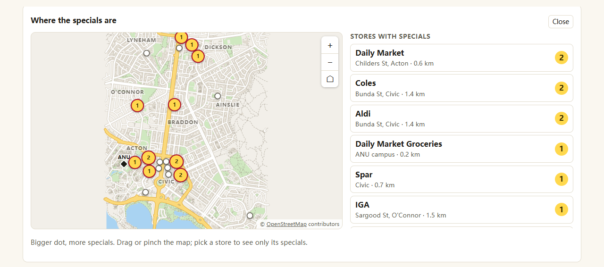
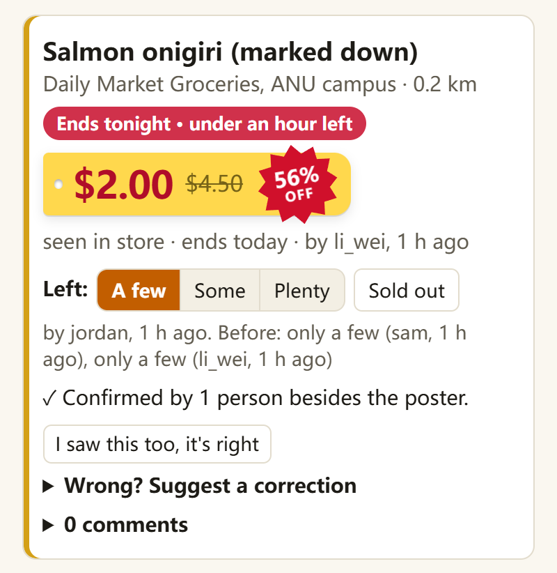
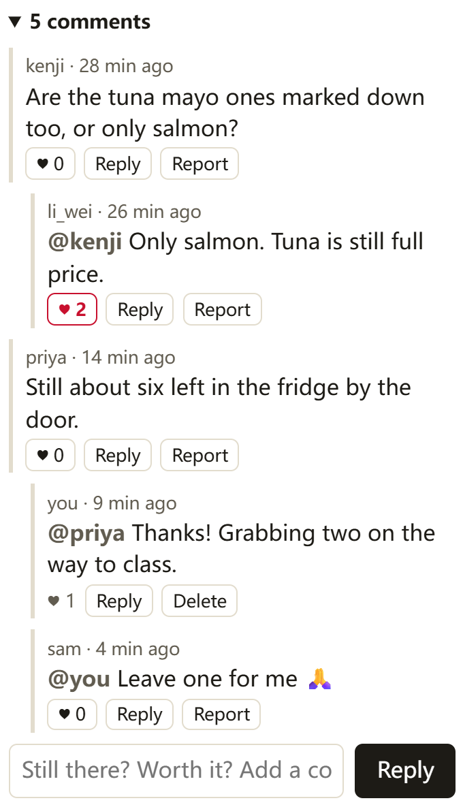
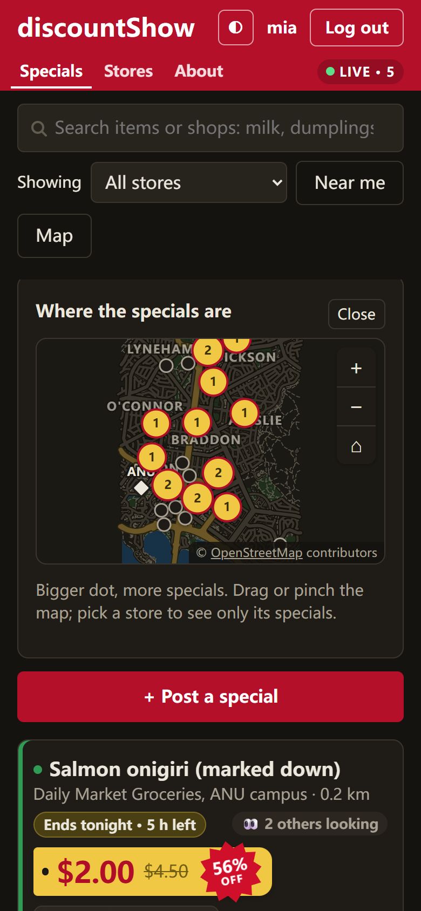
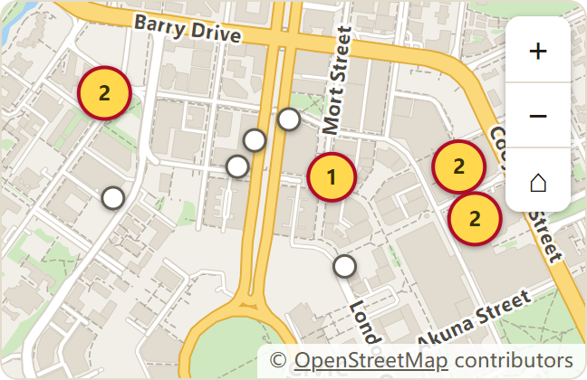
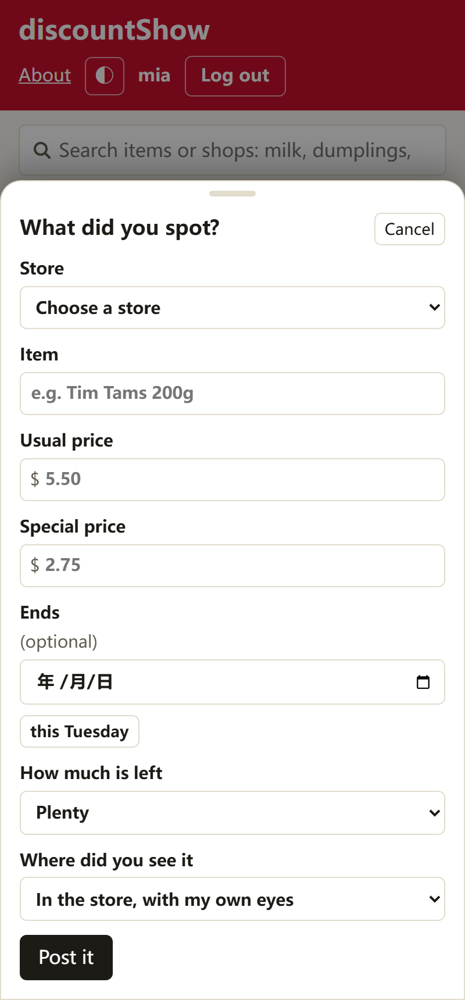
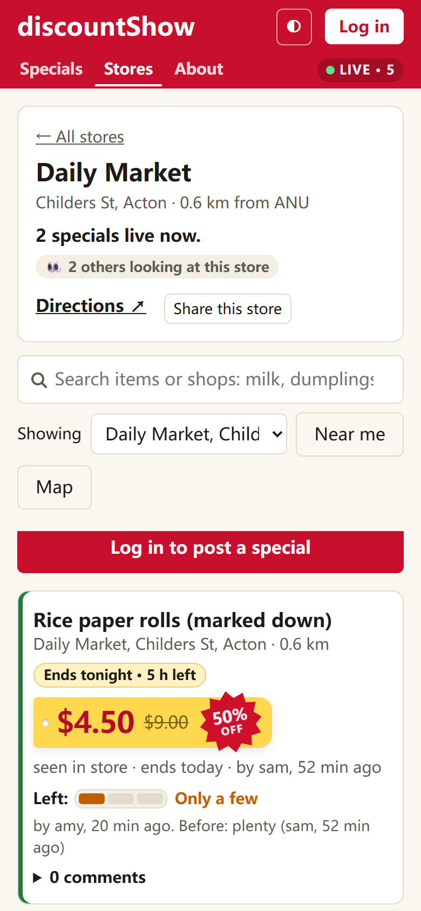
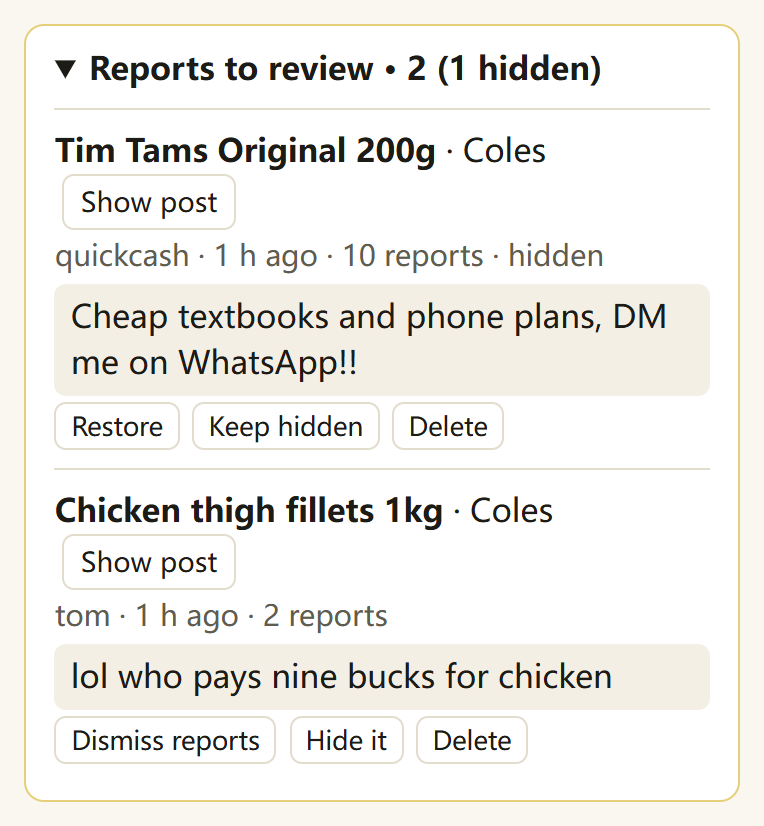

# discountShow

**分享 ANU 周边门店的特价，也让后来的人知道还有没有货。**

discountShow 是一个面向 ANU 周边学生的线下门店特价分享网站，覆盖超市、亚洲杂货店和便利店。用户可以分享店内折扣，并持续补充价格、有效期和库存信息，帮助其他人判断是否值得到店购买。

不登录也能浏览和搜索特价；登录后，可以发布帖子、确认信息、提出纠错、报告库存，以及上传价签照片和参与评论。

[在线体验](https://comp4020-final-hhhfff-hhhfff.fly.dev/) · [英文项目说明](../README.md) · [开发过程](../PROCESS.md)

## 界面预览

### 找特价、看附近的店

列表用价签样式突出价格，并显示信息的新鲜程度和最近的库存报告。新帖子先以提示按钮出现，点击后才载入，避免把正在阅读的内容挤走。桌面上的卡片采用瀑布流，展开评论时不会在旁边一列留下整块空白。



地图展示附近店铺及其在售特价数量。点击店铺可以进入对应页面，查看特价、打开导航或分享链接。地图使用预先保存的 OpenStreetMap 数据，浏览时不需要调用第三方地图服务。



### 手机上的阅读与互动

手机端可以查看价签照片、库存变化和评论，也支持暗色模式。地图保持较低的高度，让第一屏留出展示特价的位置。

<p>
  
  
  
</p>

从左到右：特价卡片、评论区、暗色模式。

<p>
  
  
  
</p>

从左到右：街道地图、发帖表单、店铺页。每条特价也有独立链接，方便发给朋友。

## 一条特价怎样被更新

一个人看到折扣后，可以选择店铺，填写商品、原价、现价、截止日期和信息来源，再按需附上价签照片。页面会提示可能重复的商品；服务端也会检查，同一家店的同一件商品只能有一条有效帖子。

后来到店的人可以确认“我也看到了”，或者补充新的库存情况。如果价格、商品名或截止日期有误，也可以提出纠错。规则如下：

| 情况 | 处理方式 |
| --- | --- |
| 发布或修改价格 | 特价必须低于原价；纠错同样需要通过校验 |
| 发帖人修改自己的帖子 | 纠错立即生效 |
| 其他人提出纠错 | 需要 3 个不同账号支持同一项修改；重复投票不累计 |
| 报告库存 | 可选很多、还有、只剩几个或售罄；每个账号对同一帖子每分钟限报一次 |
| 商品售罄 | 帖子排到列表后面，并显示近期库存报告，方便读者了解变化 |
| 评论或照片被举报 | 达到 10 个不同账号后自动隐藏，交由管理员处理 |

已显示帖子的库存、评论和纠错会实时更新；有人正在卡片里输入内容时，页面会暂缓替换那张卡片。连接状态由顶栏的 Live 标记显示。卡片和店铺页还会显示有多少其他人正在查看，只显示人数，不公开读者身份。

这些机制能让信息更容易核对，但不能保证每条特价都属实。价签照片也是判断依据之一，拍摄后价格和库存仍可能变化。

## 账号与管理

游客可以浏览、搜索和查看评论、照片；登录后才能贡献内容。发帖人可以管理自己的帖子和照片，管理员可以处理其他人的帖子、评论、照片及举报。

管理员身份只由服务器的 `ADMIN_USERS` 配置决定，不能通过注册或接口自行获得。所有权限都在服务端检查，页面是否显示按钮不影响权限判断。

<details>
<summary>查看管理员举报收件箱</summary>

<p>
  
</p>

被隐藏和举报较多的内容优先显示，管理员可以恢复、保持隐藏或删除。

</details>

## 实现方式与取舍

应用运行在一台 256 MB 内存的 Fly.io 共享 CPU 机器上，使用一个 Node.js 进程和 SQLite 数据库。前端采用原生 HTML、CSS 和 JavaScript，服务端使用 Node.js 24 内置的 HTTP、SQLite 和加密模块；运行时的外部依赖是用于展示英文 README 的 `marked`。

应用采用单进程和本地数据库，保持部署和数据存储简单。主要实现包括：

- **用事务守住数据规则。** 查重与写入在同一个 SQLite 事务中完成；纠错生效时也重新检查价格和重复帖子，避免多人同时操作产生冲突。
- **推送变化，再读取内容。** Server-Sent Events 通知页面哪些帖子发生变化，页面再读取最新内容。新帖先提示、已有帖及时更新的取舍，记录在 [ADR 0001](../docs/decisions/0001-multi-user-decision.md)。
- **在看人数只作参考。** 人数统计保存在内存中，不保存浏览历史；已登录用户的多个标签页合并计数，游客按页面计数，因此它不是精确的独立访客数。设计过程见 [ADR 0002](../docs/decisions/0002-presence-counts.md)。
- **地图数据随应用提供。** 街道和建筑数据由脚本从 OpenStreetMap 提取后保存，前端用 SVG 绘制和处理缩放。这样不需要运行时地图 API，但数据是快照，需要重新生成才能更新。
- **减少重复计算和传输。** 服务端缓存排序结果和压缩后的静态资源；列表按页加载，页面只重新读取与当前显示内容有关的帖子。
- **控制照片和账号数据的暴露。** 照片上传前压缩，服务端再移除 EXIF、GPS、XMP 等元数据段。密码使用加盐的 scrypt 哈希，会话令牌通过 HttpOnly cookie 传递，数据库保存令牌哈希。操作日志记录账号、动作、目标和结果，避免写入密码、会话令牌或评论正文。

## 本地运行

需要 **Node.js 24 和 pnpm 11 或更新版本**。如果使用 mise，可以先运行 `mise install`，按仓库配置安装工具。

```bash
git clone https://github.com/HHHFFF-HHHFFF/discountShow.git
cd discountShow
pnpm install
pnpm dev
```

默认访问 <http://localhost:8080>。`pnpm dev` 会在服务端代码变化后自动重启。需要指定数据目录或管理员时，可以这样启动：

```bash
PORT=8080 DATA_DIR=.localdata ADMIN_USERS=admin node server/server.ts
```

Windows PowerShell：

```powershell
$env:PORT = "8080"
$env:DATA_DIR = ".localdata"
$env:ADMIN_USERS = "admin"
node server/server.ts
```

`ADMIN_USERS` 填写管理员用户名，多个用户名用逗号分隔；对应账号仍需注册。未配置时也可以正常使用普通用户功能。

### 测试

```bash
pnpm check
```

这会运行 TypeScript 类型检查和测试。默认情况下，测试在临时数据目录中启动独立应用，结束后清理，不需要先启动开发服务器。若设置了 `APP_URL`，测试会使用指定实例；请使用专门的临时实例，不要指向日常使用的数据。针对非本机地址的写请求还有额外拦截。

当前测试覆盖价格与查重、三人纠错、库存报告、账号权限、照片与举报、搜索分页、分享链接、实时事件和操作日志。接口测试向实际运行的服务发送 HTTP 请求；部分页面测试在 jsdom 中运行页面脚本，检查更新顺序、在看人数和瀑布流的分列逻辑。测试方式和隔离规则见 [spec/README.md](../spec/README.md)。

这些检查不能代替真实浏览器中的布局和交互测试，也不能证明学生会长期使用这个网站。

### 更新地图数据

```bash
node scripts/streets.ts
```

脚本通过 Overpass 获取 OpenStreetMap 数据，并生成 `public/streets.json`；原始响应缓存在 `.osm-cache/`。日常启动应用不需要运行这一步。

## 代码导航

| 目录或文件 | 内容 |
| --- | --- |
| `server/server.ts` | HTTP 路由、输入校验、静态文件和页面响应 |
| `server/db.ts` | SQLite 存储、事务和众包规则 |
| `server/auth.ts` | 角色权限、密码哈希和会话 |
| `server/events.ts` | SSE 推送与在看人数统计 |
| `server/match.ts` | 商品名匹配与搜索 |
| `server/photos.ts`、`server/log.ts` | 照片处理与操作日志 |
| `public/` | 页面、样式、交互脚本和地图数据 |
| `spec/` | 接口与页面行为测试 |
| `docs/` | 开发规则、设计决策和截图 |

页面入口包括 `/`、`/stores`、`/stores/:id`、`/deals/:id` 和 `/login`。根目录的英文 `README.md` 也会完整展示在应用的 `/readme/` 页面。

## 部署与项目记录

线上应用从[课程仓库](https://github.com/comp4020-agentic-coding-studio/comp4020-final-hhhfff-hhhfff)部署到 Fly.io，SQLite 数据保存在 `/data` 持久卷中。这个个人仓库保留项目代码和记录，CI 运行检查，但不触发线上部署。

关于实现以外的思考，可以继续阅读：

- [PROCESS.md](../PROCESS.md)：项目起点、开发中的判断和改进。
- [reflections/](../reflections/)：各次课堂评议后的反思。
- [research-note.md](../research-note.md)：对 agent 工作流复杂度的讨论。
- [docs/development.md](../docs/development.md)：开发时需要遵守的具体规则。

地图数据来自 [OpenStreetMap contributors](https://www.openstreetmap.org/copyright)，按 ODbL 许可使用。

## 目前的限制

信息更新仍依赖参与者。贡献者较少时，库存可能过时，三人共识纠错也可能迟迟无法生效；地图动画和在看人数是否有实际帮助，还需要继续观察。实时连接目前最多支持 300 个页面。

项目主要展示当前价格和库存，暂不提供价格历史、网站抓取和小票照片。历史购买记录不能直接说明现在还有货，抓取也覆盖不了没有网站的小店。邮箱登录和自助找回密码目前尚未实现，因此账号恢复也是现有的限制。
